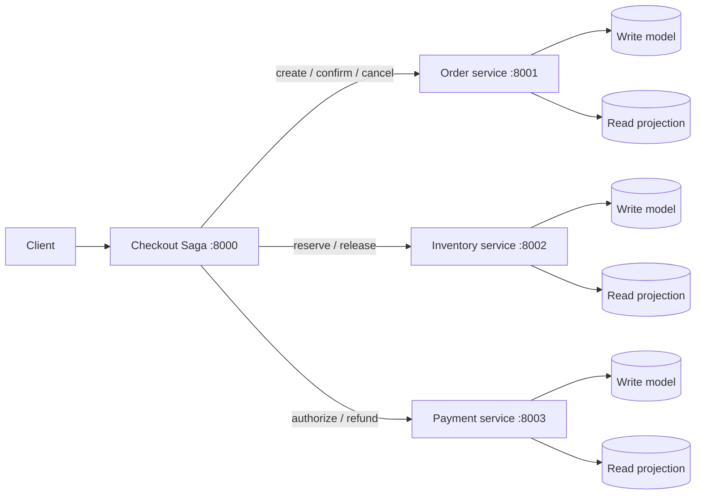

# FastAPI CQRS + Saga example

This repository is a small, executable checkout system built to make two patterns visible:

- **CQRS:** commands change an aggregate in a write store; domain events update a separate,
  denormalized read projection used by queries.
- **Saga:** one local transaction cannot span several services, so the checkout orchestrator
  runs local transactions and invokes compensating actions when a later step fails.

The repository has two infrastructure modes. The default in-memory mode keeps unit tests fast.
Docker Compose runs the production-learning mode with service-owned PostgreSQL databases,
RabbitMQ, Redis, asynchronous projections, durable Saga recovery, tracing, and metrics.

> New to these patterns? Follow the step-by-step [Learning Guide](docs/LEARNING_GUIDE.md).
> It gives you a reading order, traces real requests through the code, and includes exercises.

> Studying distributed production patterns? Use the
> [Production Evolution Guide](docs/production/README.md), which documents each infrastructure
> capability and its failure semantics.

## Architecture



Each service follows the dependency direction `api -> application -> domain`. Infrastructure
implements application-owned protocols, so the domain does not depend on FastAPI, HTTP, or a
database.

```text
services/<service>/app/
├── api/              # HTTP schemas and thin route adapters
├── application/      # commands, queries, handlers, and ports
├── domain/           # aggregates, value objects, events, invariants
├── infrastructure/   # memory/PostgreSQL repositories, workers, or HTTP adapters
└── main.py            # composition root
```

## Run it

With Docker:

```bash
docker compose up --build
```

Or locally (Python 3.11+):

```bash
python -m venv .venv
source .venv/bin/activate
pip install -e '.[dev]'

uvicorn services.order_service.app.main:app --port 8001
uvicorn services.inventory_service.app.main:app --port 8002
uvicorn services.payment_service.app.main:app --port 8003
uvicorn services.saga_orchestrator.app.main:app --port 8000
```

Each service exposes `/health` and interactive OpenAPI documentation at `/docs`.

## Exercise the Saga

Successful checkout (`tok_ok` can be any value except `tok_fail`):

```bash
curl -s http://localhost:8000/api/v1/checkouts \
  -H 'Content-Type: application/json' \
  -H 'Idempotency-Key: checkout-demo-1' \
  -d '{
    "customer_id": "customer-1",
    "items": [{"sku": "LAPTOP", "quantity": 1}],
    "amount": "999.00",
    "payment_method_token": "tok_ok"
  }'
```

The forward path is:

```text
create order -> reserve inventory -> authorize payment -> confirm order
```

Change the token and idempotency key to trigger a deterministic decline:

```bash
curl -s http://localhost:8000/api/v1/checkouts \
  -H 'Content-Type: application/json' \
  -H 'Idempotency-Key: checkout-demo-failure-1' \
  -d '{
    "customer_id": "customer-1",
    "items": [{"sku": "LAPTOP", "quantity": 1}],
    "amount": "999.00",
    "payment_method_token": "tok_fail"
  }'
```

The compensation path is:

```text
payment declined -> release inventory -> cancel order
```

The response contains the complete Saga timeline. Query it later with
`GET /api/v1/sagas/{saga_id}`. Commands use stable idempotency keys, and compensation endpoints
are themselves idempotent, so retrying a network call does not reserve, refund, or cancel twice.

## Where CQRS appears

For example, an order command follows this path:

```text
POST route -> CreateOrder command -> command handler -> Order aggregate -> write repository
                                                    -> OrderChanged event -> read projection
```

An order query does not load the aggregate:

```text
GET route -> GetOrder query -> query handler -> read projection
```

In memory mode, projection updates are synchronous for deterministic tests. Docker mode uses the
outbox, RabbitMQ, inbox, and asynchronous PostgreSQL projections, so the read side is
**eventually consistent**: a successful command can briefly precede the updated query response.

## Verification

```bash
make test
make lint
make typecheck
```

The suite covers command/query projection behavior, inventory atomicity, idempotency, successful
Saga execution, reverse-order compensation, and an end-to-end declined-payment flow through the
real FastAPI HTTP contracts.

## What changes in production

In-memory data disappears on restart and cannot be shared across replicas. A production version
would normally use:

- PostgreSQL transactions for write models and durable Saga state;
- a read-optimized PostgreSQL schema, Elasticsearch, or another projection store;
- a transactional outbox so the aggregate change and event publication commit atomically;
- Kafka or RabbitMQ consumers that update projections with deduplication and checkpoints;
- a worker that resumes `running`, `compensating`, and `failed` Sagas after a crash;
- bounded retries with backoff, circuit breakers, timeouts, metrics, tracing, and alerting;
- secrets from a vault and a real payment provider token (never raw card data);
- authentication/authorization and schema migrations.

The orchestrator catches broad exceptions intentionally at its process boundary: an unexpected
downstream or transport failure must be converted into durable Saga state. Domain and route code
use narrower exceptions.

