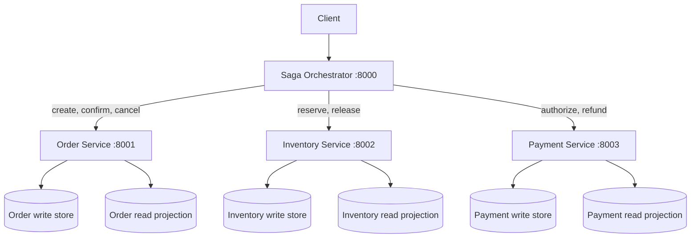
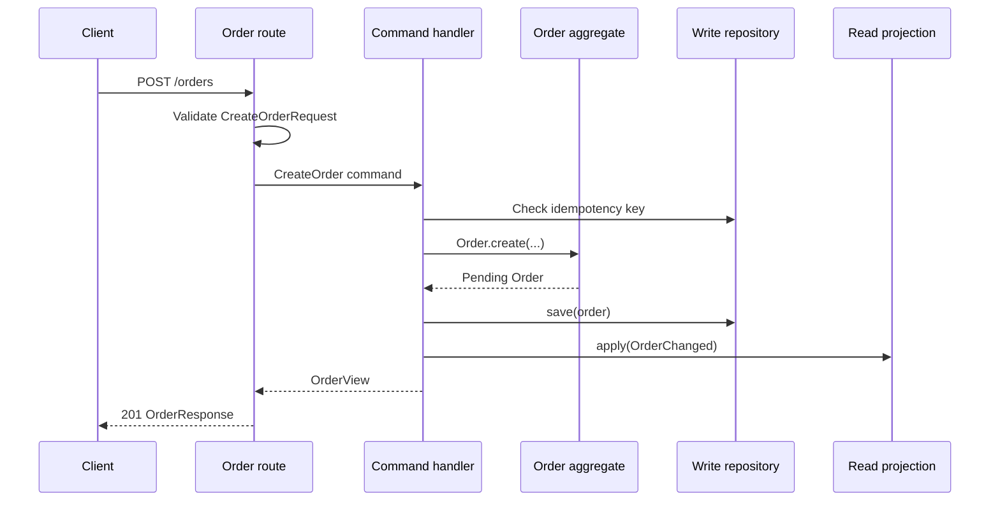
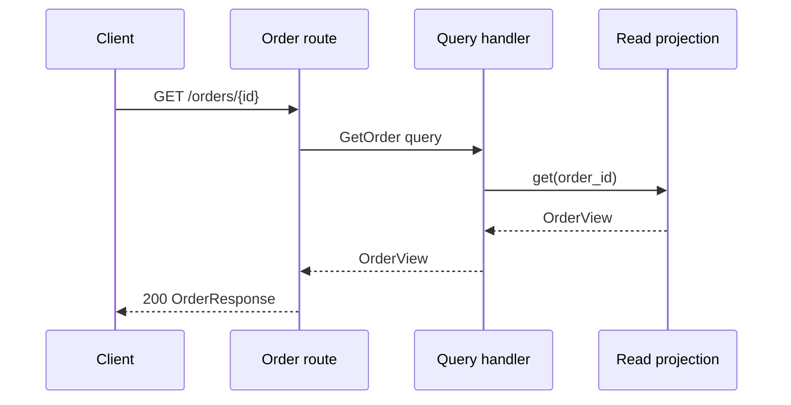
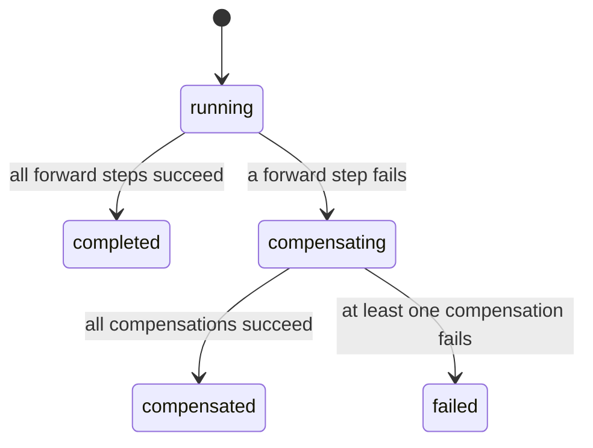
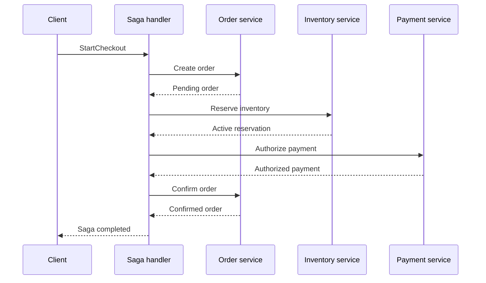
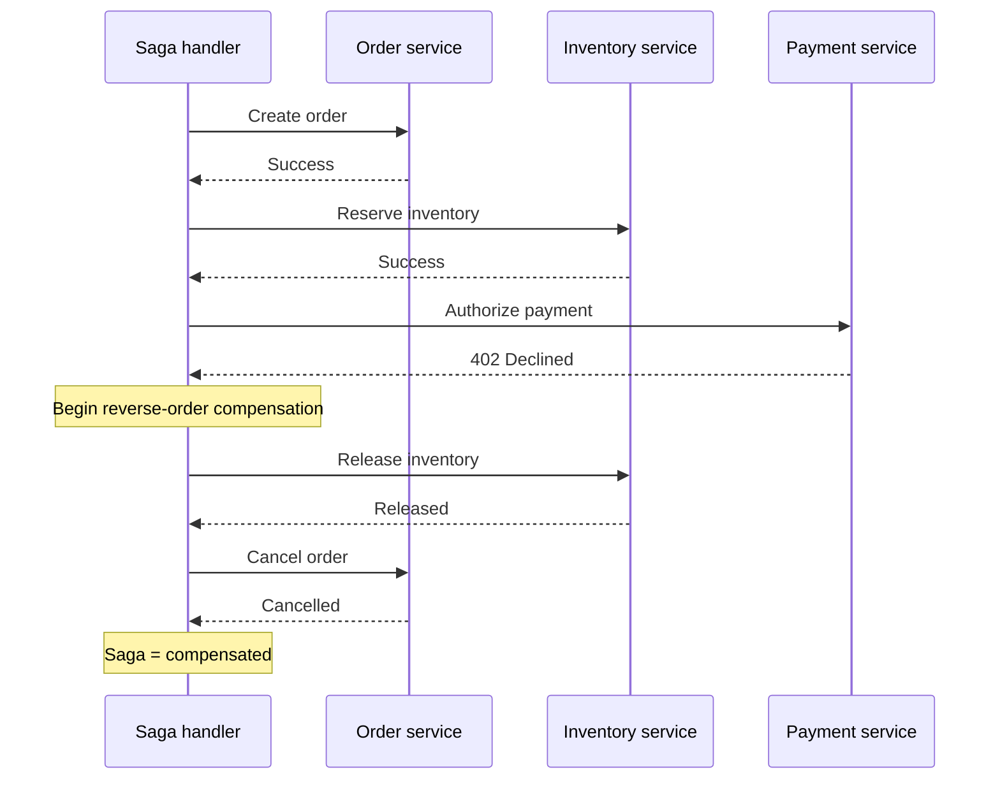

# Learning Guide: How CQRS and Saga Fit Together

This guide is the recommended path through the repository. Do not begin by reading every file
from top to bottom. First follow one order command, then one order query, and only then study the
multi-service Saga.

By the end, you should be able to explain:

1. what a command and a query are;
2. why their handlers use different models;
3. how a domain event updates a read projection;
4. why CQRS does not require a Saga;
5. how the checkout Saga coordinates independent services;
6. how compensation, idempotency, and correlation IDs make distributed work safer;
7. which pieces must become durable in a production system.

## 1. The mental model

CQRS and Saga are separate patterns.

| Pattern | Problem it solves | Where it appears here |
|---|---|---|
| CQRS | Reads and writes have different responsibilities and can use different models | Inside order, inventory, payment, and Saga services |
| Saga | One business operation spans services that cannot share a database transaction | Checkout orchestration across order, inventory, and payment |

CQRS in one sentence:

```text
Command -> change business state -> update a query-friendly projection
Query   -> read the projection -> never change business state
```

Saga in one sentence:

```text
Run local transactions in sequence; if one fails, undo completed work with compensating actions.
```

The checkout system combines them, but neither pattern requires the other.

## 2. System map



Each service owns its state. The orchestrator does not directly access the dictionaries inside
order, inventory, or payment. It communicates through HTTP, just as separately deployed services
would.

### Folder responsibilities

Every service uses the same dependency shape:

```text
app/
├── api/
│   ├── routes.py       HTTP transport; validates input and selects a use case
│   └── schemas.py      Request and response shapes
├── application/
│   ├── commands.py     Intent to change state
│   ├── queries.py      Intent to retrieve state
│   ├── handlers.py     Use-case orchestration
│   └── ports.py        Interfaces required by application code
├── domain/
│   ├── models.py       Business state and rules
│   └── events.py       Facts that occurred in the domain
├── infrastructure/
│   └── ...             In-memory persistence or outbound HTTP implementation
└── main.py              Composition root: constructs and connects everything
```

The dependency direction is important:

```text
API -> Application -> Domain
          ^
          |
Infrastructure implements Application ports
```

The domain does not import FastAPI, HTTPX, or an in-memory repository. That makes the business
rules testable without running a server and lets infrastructure be replaced later.

## 3. Prepare the project

Use Docker if your host does not have Python 3.11 or newer:

```bash
docker compose up --build
```

The services are then available at:

| Service | URL | OpenAPI UI |
|---|---|---|
| Saga orchestrator | `http://localhost:8000` | `http://localhost:8000/docs` |
| Order | `http://localhost:8001` | `http://localhost:8001/docs` |
| Inventory | `http://localhost:8002` | `http://localhost:8002/docs` |
| Payment | `http://localhost:8003` | `http://localhost:8003/docs` |

If one of those ports is already occupied, stop the conflicting process or change the host side
of its mapping in `docker-compose.yml`.

Run the automated checks before studying the implementation:

```bash
source .venv/bin/activate
make test
make lint
make typecheck
```

The tests are executable documentation. Return to them throughout this guide.

## 4. First pass: understand one CQRS service

Study only the order service on the first pass. Ignore the Saga, inventory, and payment services.

Read these files in order:

1. `services/order_service/app/main.py`
2. `services/order_service/app/api/schemas.py`
3. `services/order_service/app/api/routes.py`
4. `services/order_service/app/application/commands.py`
5. `services/order_service/app/application/handlers.py`
6. `services/order_service/app/domain/models.py`
7. `services/order_service/app/domain/events.py`
8. `services/order_service/app/application/ports.py`
9. `services/order_service/app/infrastructure/memory.py`

### 4.1 Start at the composition root

Open `order_service/app/main.py` and find `create_app()`.

It constructs:

- `InMemoryOrderWriteRepository`, which stores domain aggregates;
- `InMemoryOrderReadModel`, which stores query-friendly views;
- `OrderCommandHandler`, which receives the write repository and read model;
- `OrderQueryHandler`, which receives only the read model;
- the HTTP router, which receives both handlers.

This wiring shows a key CQRS rule: the query handler does not need the write repository.

### 4.2 Trace the Create Order command

Send a command directly to the order service:

```bash
curl -i http://localhost:8001/api/v1/orders \
  -H 'Content-Type: application/json' \
  -H 'Idempotency-Key: learn-order-1' \
  -d '{
    "order_id": "order-learning-1",
    "customer_id": "customer-1",
    "items": [{"sku": "LAPTOP", "quantity": 1}],
    "total": "999.00"
  }'
```

Follow it through the code:



Notice the responsibilities:

- `CreateOrderRequest` is an HTTP input model. It is allowed to know about JSON validation.
- `CreateOrder` is a transport-independent application message.
- `Order.create()` enforces business rules such as a nonempty order and positive total.
- the write repository stores `Order`, the domain model;
- `OrderChanged` describes a fact that has happened;
- the read model converts the aggregate into `OrderView`;
- `OrderResponse` converts that view into an HTTP response.

The separate classes may look repetitive in a small example. Their value appears when the HTTP
shape, domain model, database schema, and query result need to evolve independently.

### 4.3 Trace the Get Order query

Now read the created order:

```bash
curl -s http://localhost:8001/api/v1/orders/order-learning-1
```

The path is shorter:



The query does not:

- load an `Order` aggregate;
- invoke domain behavior;
- write to either store;
- emit an event.

That is the practical meaning of command/query separation in this repository.

### 4.4 Inspect the aggregate

Open `order_service/app/domain/models.py` and study these methods:

- `Order.create()` creates only valid pending orders;
- `Order.confirm()` allows `pending -> confirmed`;
- `Order.cancel()` allows `pending -> cancelled`;
- confirming an already confirmed order is idempotent;
- cancelling an already cancelled order is idempotent;
- a confirmed order cannot be cancelled.

The methods return new immutable dataclass instances rather than changing the current object.
The `version` increases after a state transition and demonstrates optimistic concurrency.

Try the invalid transition:

```bash
curl -X POST http://localhost:8001/api/v1/orders/order-learning-1/confirm
curl -i -X POST http://localhost:8001/api/v1/orders/order-learning-1/cancel
```

The second request should return `409 Conflict`. Follow the `ValueError` from the aggregate to the
route's HTTP error mapping.

### 4.5 Compare the two in-memory stores

Open `order_service/app/infrastructure/memory.py`.

`InMemoryOrderWriteRepository` stores `Order` objects and supports the command side. It contains:

- aggregates keyed by order ID;
- idempotency-key lookup;
- a lock around writes;
- a simplified version check.

`InMemoryOrderReadModel` stores `OrderView` objects and supports the query side. Its data is a
denormalized projection intended for direct retrieval.

They are two different dictionaries even though they live in one process. In a production CQRS
system they could be two schemas or entirely different databases.

### 4.6 Understand projection timing

The handler currently performs these operations synchronously:

```text
save aggregate -> apply domain event to projection -> return response
```

This makes the example deterministic: a query immediately sees the command result. With a broker,
the typical flow becomes:

```text
save aggregate + outbox event -> return -> broker -> projection consumer -> update read store
```

The second design is eventually consistent. Immediately after a successful command, the query
side may briefly return old data. CQRS itself does not require asynchronous events; this is an
architectural choice.

## 5. Second pass: compare the other CQRS services

Once the order service is clear, do not reread every line. Look specifically for what differs.

### Inventory service

Start with:

- `inventory_service/app/domain/models.py`
- `inventory_service/app/infrastructure/memory.py`
- `inventory_service/app/application/handlers.py`
- `inventory_service/app/api/routes.py`

Important ideas:

- checking availability and reserving stock must be atomic;
- all requested items are validated before any stock is changed;
- an `asyncio.Lock` represents the transaction boundary in memory;
- retrying the same idempotency key returns the existing reservation;
- releasing an already released reservation is safe;
- the stock query reads `available = on_hand - reserved` from its projection.

Try reserving more stock than exists and confirm that no partial reservation is left behind.

### Payment service

Start with:

- `payment_service/app/domain/models.py`
- `payment_service/app/infrastructure/memory.py`
- `payment_service/app/application/handlers.py`
- `payment_service/app/api/routes.py`

Important ideas:

- `tok_fail` is a fake provider response used to create a deterministic decline;
- the declined payment is still stored and projected before the API returns `402`;
- this means a later query can explain the failure;
- refund is idempotent, preventing a repeated compensation from refunding twice;
- sensitive payment tokens do not appear in the persisted `Payment` model.

At this point, you have understood CQRS. Nothing studied in sections 4 and 5 requires a Saga.

## 6. Third pass: understand the Saga

Now study the distributed checkout operation.

Read these files in order:

1. `saga_orchestrator/app/domain/models.py`
2. `saga_orchestrator/app/application/commands.py`
3. `saga_orchestrator/app/application/handlers.py`
4. `saga_orchestrator/app/application/ports.py`
5. `saga_orchestrator/app/infrastructure/http_gateway.py`
6. `saga_orchestrator/app/infrastructure/memory.py`
7. `saga_orchestrator/app/api/routes.py`
8. `saga_orchestrator/app/main.py`

### 6.1 Why a database transaction is insufficient

Checkout changes three independently owned stores:

```text
Order service       creates and confirms an order
Inventory service   reserves stock
Payment service     authorizes money
```

The orchestrator cannot wrap those HTTP calls in one local SQL transaction. If payment fails
after stock has been reserved, it must perform new business operations that reverse prior work.
Those reversals are compensations, not database rollbacks.

### 6.2 The Saga is an explicit state machine

Open `saga_orchestrator/app/domain/models.py`.

`CheckoutSaga` stores:

- its own ID and the client's idempotency key;
- the IDs of the order, reservation, and payment it coordinates;
- its current `SagaStatus`;
- an ordered timeline of `SagaStep` records;
- a failure reason when forward execution fails.

The possible Saga statuses are:



`compensated` is not the same as `completed`:

- `completed` means checkout succeeded;
- `compensated` means checkout failed, but completed work was successfully undone;
- `failed` means compensation itself failed and an operator or recovery worker must intervene.

### 6.3 Follow the happy path

Send a successful checkout:

```bash
curl -s http://localhost:8000/api/v1/checkouts \
  -H 'Content-Type: application/json' \
  -H 'Idempotency-Key: learn-checkout-success-1' \
  -d '{
    "customer_id": "customer-1",
    "items": [{"sku": "LAPTOP", "quantity": 1}],
    "amount": "999.00",
    "payment_method_token": "tok_ok"
  }'
```

`CheckoutSagaHandler.execute()` runs:



After each successful call, `_forward()` records a step and `_persist()` writes the Saga and
updates its query projection. The `completed` list is important: only successfully completed
steps are eligible for compensation.

### 6.4 Follow the payment-decline path

Use a new idempotency key and the failure token:

```bash
curl -s http://localhost:8000/api/v1/checkouts \
  -H 'Content-Type: application/json' \
  -H 'Idempotency-Key: learn-checkout-failure-1' \
  -d '{
    "customer_id": "customer-1",
    "items": [{"sku": "LAPTOP", "quantity": 1}],
    "amount": "999.00",
    "payment_method_token": "tok_fail"
  }'
```

Trace the failure across service boundaries:

1. order creation succeeds, so `create_order` enters `completed`;
2. inventory reservation succeeds, so `reserve_inventory` enters `completed`;
3. payment stores a declined payment and returns HTTP `402`;
4. `HttpCommerceGateway` converts the error response into `DownstreamServiceError`;
5. the Saga handler catches the boundary failure and switches to `compensating`;
6. completed steps are inspected in reverse order;
7. inventory is released;
8. the order is cancelled;
9. the Saga becomes `compensated`.



There is no refund in this path because authorization never succeeded. If order confirmation
failed after authorization, the completed steps would include payment, and compensation would be:

```text
refund payment -> release inventory -> cancel order
```

Reverse order reduces the chance that a compensation depends on state already removed by an
earlier compensation.

### 6.5 Understand the gateway port and adapter

`CommerceGateway` in `application/ports.py` is an interface owned by the application layer. The
handler knows that it can request `create_order()` or `reserve_inventory()`, but it does not know
about URLs, JSON, HTTPX, or timeouts.

`HttpCommerceGateway` in `infrastructure/http_gateway.py` implements that interface. It is
responsible for:

- building downstream URLs and JSON bodies;
- setting timeouts;
- forwarding the correlation ID;
- creating stable downstream idempotency keys;
- turning transport and error responses into exceptions.

This is dependency inversion: application policy defines what it needs; infrastructure supplies
the technical implementation.

## 7. Cross-cutting safety mechanisms

### Idempotency

Networks can fail after a server commits but before the caller receives the response. The caller
cannot know whether the operation happened, so it must retry. Without idempotency, a retry could
reserve stock or charge money twice.

This project uses two levels:

1. the client sends an `Idempotency-Key` to the Saga or individual service;
2. the Saga derives stable keys such as `<saga-id>:authorize-payment` for downstream commands.

The in-memory repositories map each key to its previously created resource. Compensations are also
state-idempotent: releasing released inventory, refunding a refunded payment, or cancelling a
cancelled order is safe.

### Correlation IDs

`services/shared/api.py` accepts or creates `X-Correlation-ID`, stores it in a context variable,
adds it to logs and responses, and the HTTP gateway forwards it downstream. One identifier can
therefore connect the logs from all services involved in a checkout.

Try it:

```bash
curl -i http://localhost:8000/health -H 'X-Correlation-ID: learning-trace-1'
```

### Optimistic concurrency and locks

- the order write repository demonstrates a version check;
- inventory holds a lock across availability checking and reservation writing;
- repositories use locks so concurrent async requests cannot interleave critical writes.

These are educational in-memory equivalents. A database implementation would use transactions,
unique constraints, compare-and-swap updates, or row locks.

## 8. Learn through the tests

Read the tests in this order:

1. `tests/test_service_cqrs.py`
2. `tests/test_saga_handler.py`
3. `tests/test_checkout_end_to_end.py`

### `test_service_cqrs.py`

This proves that:

- a command updates the order projection;
- inventory idempotency prevents a duplicate reservation;
- a declined payment remains queryable.

### `test_saga_handler.py`

`RecordingGateway` replaces HTTP with a test double. This isolates Saga policy and proves:

- forward steps run in the expected order;
- payment failure causes reverse-order compensation;
- replaying the same Saga idempotency key does not execute it again.

Notice how easy this is because the handler depends on the `CommerceGateway` protocol rather than
constructing HTTP clients itself.

### `test_checkout_end_to_end.py`

This starts all FastAPI applications in process and communicates through their HTTP contracts. It
verifies the final distributed outcome:

- Saga is `compensated`;
- order is `cancelled`;
- reserved stock is restored.

Run one test verbosely while reading its code:

```bash
pytest -vv -s tests/test_checkout_end_to_end.py
```

## 9. Suggested debugger breakpoints

For a successful checkout, place breakpoints in this order:

1. `saga_orchestrator/app/api/routes.py` — `start_checkout()`
2. `saga_orchestrator/app/application/handlers.py` — `execute()`
3. `saga_orchestrator/app/infrastructure/http_gateway.py` — `create_order()`
4. `order_service/app/api/routes.py` — `create_order()`
5. `order_service/app/application/handlers.py` — `create()`
6. `order_service/app/domain/models.py` — `Order.create()`
7. `order_service/app/infrastructure/memory.py` — both `save()` and `apply()`
8. return to Saga `_forward()` and observe the recorded step.

For a failed checkout, additionally break at:

1. `payment_service/app/infrastructure/memory.py` — the `tok_fail` branch;
2. `saga_orchestrator/app/infrastructure/http_gateway.py` — `_post()` error mapping;
3. the `except` block in Saga `execute()`;
4. `_compensate()` and each reverse action.

## 10. Exercises

Complete these in order. Run the tests after every change.

### Beginner

1. Add `SHIPPED` to `OrderStatus`. Add a domain method that permits only
   `confirmed -> shipped`, then add its command, handler method, route, and test.
2. Add a query endpoint that returns only active inventory reservations. Do not read the write
   repository from the query handler.
3. Add a test proving that repeating an order creation idempotency key returns the same order.

### Intermediate

1. Extend `RecordingGateway` so `confirm_order` fails. Assert that compensation executes
   `refund_payment`, `release_inventory`, and `cancel_order` in that order.
2. Add a controlled failure to `release_inventory`. Confirm the Saga ends as `failed` and its
   step timeline contains `compensation_failed`.
3. Change the order read projection to include `item_count` without adding that field to the
   `Order` aggregate. This demonstrates independent query-model design.

### Advanced

1. Replace only the order write repository with SQLite or PostgreSQL while keeping the handler and
   domain unchanged.
2. Implement an outbox record in the same transaction as an order write. Create a worker that
   applies outbox events to the read projection.
3. Persist Saga state and write a recovery worker that resumes `running` or `compensating` Sagas
   after process restart.
4. Introduce bounded retries for transport failures, but do not retry permanent business errors
   such as payment decline or insufficient stock.

## 11. What is simplified versus production

The folder boundaries and interactions are production-shaped, but the infrastructure is kept
small for learning.

| This repository | Typical production implementation |
|---|---|
| In-memory dictionaries | PostgreSQL, DynamoDB, or another durable store |
| Synchronous projection update | Transactional outbox, broker, and projection consumer |
| In-process Saga persistence | Durable Saga table and recovery worker |
| One process per service | Multiple replicas behind service discovery/load balancing |
| Basic structured logs | Central logs, traces, metrics, dashboards, and alerts |
| Fixed HTTP timeout | Per-operation policies, retry budgets, circuit breakers |
| Fake payment token | Vault-managed credentials and provider tokenization |
| No authentication | Service identity plus user authorization |

Two especially important production gaps are:

1. **Atomic event publication:** saving an aggregate and publishing its event must not leave one
   committed without the other. The transactional outbox solves this.
2. **Durable Saga recovery:** after a crash, a worker must discover unfinished Sagas and safely
   continue forward execution or compensation.

## 12. Common misconceptions

**“CQRS means microservices.”**  
No. A modular monolith or a single service can use separate command and query paths.

**“CQRS requires two databases.”**  
No. Logical separation is the essential part. Separate physical databases are an optional scaling
decision.

**“CQRS requires event sourcing.”**  
No. This repository stores current aggregate state. Event sourcing would store the event history
as the source of truth.

**“A compensation is a rollback.”**  
Not exactly. It is a new business transaction that counteracts an earlier one. It can fail and
must be observable and retryable.

**“A compensated Saga succeeded.”**  
The technical recovery succeeded, but the requested checkout did not. The client or business
workflow must treat `completed` and `compensated` differently.

**“Every command needs a Saga.”**  
No. Use a Saga only when one business operation crosses independent transaction boundaries and
requires coordination or compensation.

## 13. Final self-check

Before considering the repository understood, answer these without looking at the code:

1. Why does `OrderQueryHandler` receive no write repository?
2. What changes in the flow if projection updates become asynchronous?
3. Why is stock validation inside the same lock as stock reservation?
4. Why is a declined payment stored even though the API returns an error?
5. Why does the Saga compensate only entries in its `completed` list?
6. Why are compensations executed in reverse order?
7. Why does payment decline not trigger a refund?
8. What is the difference between `compensated` and `failed`?
9. Where are client and downstream idempotency handled?
10. Which two mechanisms are missing for reliable crash recovery in production?

If you can trace both the Create Order command and the declined-payment Saga from HTTP request to
final read models, and answer these questions, you understand how the major pieces fit together.
