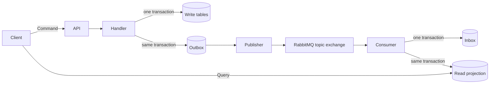

# Production Evolution Guide

This section documents the ten production patterns added to the CQRS/Saga example. Start the
complete stack with:

```bash
docker compose up --build
```

The application code still defaults to `PERSISTENCE_BACKEND=memory`, which keeps unit tests fast
and isolated. Docker Compose selects `postgres` and supplies RabbitMQ, Redis, and telemetry.

## End-to-end data path



The delivery guarantee is **at least once**. The outbox prevents lost events; RabbitMQ may
redeliver; the inbox makes projection processing effectively once per event ID.

## Documents

1. [PostgreSQL write repositories](01-postgresql-repositories.md)
2. [Transactional outbox](02-transactional-outbox.md)
3. [RabbitMQ event delivery](03-rabbitmq-delivery.md)
4. [Inbox and deduplication](04-inbox-deduplication.md)
5. [Asynchronous read projections](05-asynchronous-projections.md)
6. [Durable Saga recovery](06-durable-saga-recovery.md)
7. [Timeouts, retries, and circuit breakers](07-resilience.md)
8. [OpenTelemetry tracing and Prometheus metrics](08-observability.md)
9. [Contract tests](09-contract-tests.md)
10. [Distributed rate limiting](10-rate-limiting.md)

## Operational endpoints

| Component | Address |
|---|---|
| Checkout API | `http://localhost:8000` |
| Order API | `http://localhost:8001` |
| Inventory API | `http://localhost:8002` |
| Payment API | `http://localhost:8003` |
| RabbitMQ management | `http://localhost:15672` (`app` / `app`) |
| Jaeger tracing | `http://localhost:16686` |
| Prometheus | `http://localhost:9090` |

Each API exposes `/health`, `/docs`, and `/metrics`.

If the standard ports are occupied, run an isolated, network-only stack with:

```bash
docker compose -p cqrsverify \
  -f docker-compose.yml -f docker-compose.integration.yml up --build -d
```

This override is also useful in CI, where tests can execute inside the Compose network.

## Important scope boundary

This is production-shaped learning code, not a turn-key production platform. Credentials are
intentionally local, schema creation is automatic rather than migration-driven, and the stack
lacks TLS, authentication, secret management, backup policies, and deployment manifests. Each
chapter identifies the remaining operational work.

